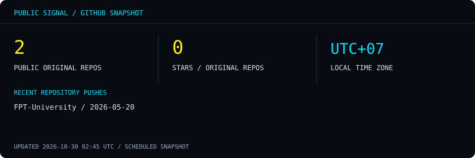
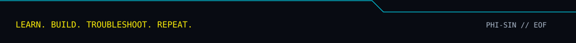

## 01 / THE OPERATOR

I'm **Sin**, a freelance developer and an **IT Helpdesk / Support** employee at **Công ty TNHH Cơ Khí Xây Dựng Du Lịch Bách Tùng**. My work connects software development with practical, everyday IT support.

I work on company ERP automation and tools that support the business. Outside of work, I'm **learning IT networking** and **planning a personal RPG**.

> **Build useful things. Keep systems running. Leave useful knowledge behind.**

## 02 / SELECTED OPERATIONS

### `01` Company ERP automation

An ERP automation system for the company, connecting my development work with business operations.

**Focus:** enterprise software · workflow automation

### `02` Internal automation tools

Tools built to support the company's day-to-day work through automation.

**Focus:** practical tooling · business support

### `03` Personal RPG — planning

A personal role-playing game project, currently in the planning stage.

**Stage:** concept & planning

### `04` [FPT University Learning Archive](https://github.com/Phi-Sin/FPT-University)

Study materials and products from my **2020–2025** learning journey. A public record of learning across programming and databases.

**Explore:** [Repository & learning materials →](https://github.com/Phi-Sin/FPT-University)

## 03 / TECH ARSENAL

Languages and tools from my development and learning journey. This is a toolkit, not a proficiency ranking.

| Area | Technologies & tools |
| :--- | :--- |
| Development | C# · Java · JavaScript · PHP · C · HTML · CSS |
| Databases | T-SQL · MySQL |
| Scripting & tooling | PowerShell · Bash · Git · GitHub |
| Environment | Windows · Linux · Visual Studio · VS Code |
| Learning now | IT networking |

## 04 / PUBLIC SIGNAL

<!-- SIGNAL:START -->
Updated **2026-10-30 19:28 UTC** · Scheduled every 12 hours.

- [FPT-University](https://github.com/Phi-Sin/FPT-University) — latest repository push: 2026-05-20
<!-- SIGNAL:END -->

*Public GitHub activity is only part of my work. Company ERP and internal support work are not measured by this dashboard.*

## 05 / ESTABLISH CONNECTION

Have a development project, an IT problem, or an idea worth discussing?

